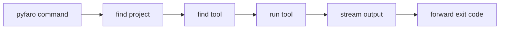

# How it works

Pyfaro is a thin Rust layer. It owns the command-line experience, project
discovery, configuration, orchestration and diagnostics. The heavy work is
delegated to the tools that already do it well:

| Command | Pyfaro's responsibility | Delegated to |
| --- | --- | --- |
| `create` | Local library and CLI templates | nothing (uv is not invoked) |
| `init` | Safe, opt-in configuration of a project | uv, for metadata and locking |
| `add`, `remove` | Consistent dependency commands | uv, for dependency editing |
| `sync` | Locked and reproducible workflow | uv, for environment sync |
| `run` | Project context and argument passthrough | uv, for execution |
| `python` | Interpreter command selection | uv, for Python management |
| `tools` | Tool discovery and diagnostics | executable and version probes |
| `lint`, `fmt` | Paths, flags, diagnostics | Ruff |
| `type` | Environment and invocation | ty |
| `check` | Non-writing aggregate quality gate | Ruff and ty |
| `test` | Environment, passthrough, status | pytest |
| `doctor` | Project and environment diagnostics | tool probes, Python metadata |

!!! success "No second resolver"
    Pyfaro contains no dependency solver, package manager, Python installer,
    lock-file format, linter, type checker or test engine. `uv.lock` belongs to
    uv, and `pyproject.toml` stays standard project metadata. If uv can do it
    today, Pyfaro does it by running uv.

## What delegation looks like

Pyfaro runs tools directly, with explicit arguments and no shell, from the
project root. Their output streams straight to your terminal. For example
`pyfaro sync` is `uv sync` with project discovery, and `pyfaro lint` is
`ruff check` with the same discovery:

A few guarantees follow from this design:

- **Native behavior.** Ruff, ty and pytest read their own configuration.
  Pyfaro does not translate or override it.
- **Controlled uv.** Pyfaro passes `--no-progress`, and `--no-python-downloads`
  except for the Python commands that need downloads. It clears environment
  variables that could silently redirect uv, listed in
  [Environment variables](../reference/environment-variables.md).
- **Cleanup.** If you press `Ctrl+C`, Pyfaro stops the whole process tree it
  started and exits with 130.
- **No surprises.** Pyfaro never installs uv or downloads Python on its own.
  Only `pyfaro python install` allows an interpreter download, and
  `--offline` forbids network access entirely.

## Tool versions

uv 0.9.26 or newer is required and checked before use. Ruff, ty and pytest are
used if they report a parseable version. The versions Pyfaro is tested with
are on the [tested versions](../reference/tested-versions.md) page.

## Next steps

- [Projects](projects.md): how the project is chosen.
- [Environments and tools](environments-and-tools.md): where the tools come from.
- [Exit codes](exit-codes.md).
