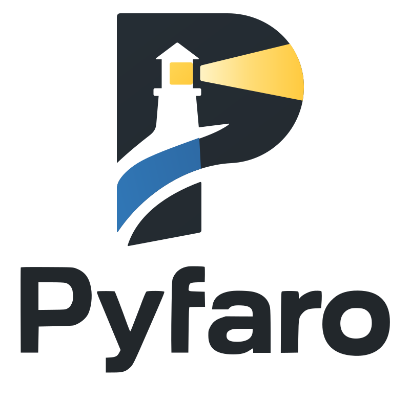
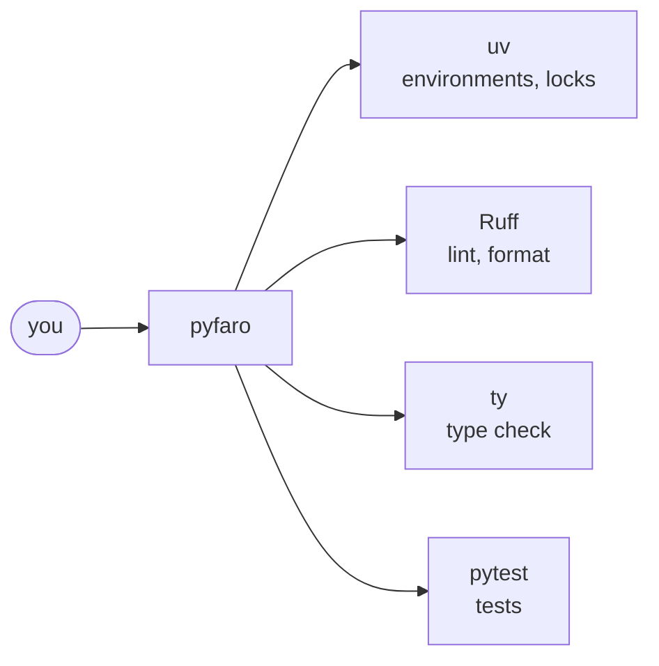

<div class="pf-hero" markdown>
<div class="pf-hero__logo" markdown>
{ .pf-logo }
</div>
<div class="pf-hero__text" markdown>

# The unified Python development toolchain { .pf-hero__title }

Pyfaro is a fast, Rust-built command-line tool: one CLI over uv, Ruff, ty and
pytest, from creating a project to running its quality checks and tests.
{ .pf-hero__lead }

<div class="pf-hero__actions" markdown>
[Get started](getting-started/index.md){ .md-button .md-button--primary }
[GitHub](https://github.com/pyfaro/pyfaro){ .md-button }
</div>

</div>
</div>

## Install

=== "Linux / macOS"

    ```sh
    curl --proto '=https' --tlsv1.2 -LsSf https://pyfaro.dev/install.sh | sh
    ```

    The script verifies the download against `SHA256SUMS`, installs to
    `~/.local/bin` and changes nothing else. Prefer to read it first?
    [Download, inspect, then run it](getting-started/installation.md#download-inspect-then-run).

=== "Windows"

    ```powershell
    powershell -ExecutionPolicy ByPass -c "irm https://pyfaro.dev/install.ps1 | iex"
    ```

    The script verifies the download against `SHA256SUMS` and installs to
    `%USERPROFILE%\.local\bin`.

=== "Cargo"

    Requires Rust 1.90 or newer.

    ```sh
    cargo install pyfaro --version 0.4.0-alpha.1 --locked
    pyfaro --version
    ```

    The explicit version is needed while every release is an alpha.

=== "Prebuilt binaries"

    Download the archive for your platform from
    [GitHub Releases](https://github.com/pyfaro/pyfaro/releases)
    (Linux x86_64 and aarch64, macOS arm64 and x86_64, Windows x86_64),
    check it against `SHA256SUMS`, and put `pyfaro` on your `PATH`.

Pyfaro needs [uv](https://docs.astral.sh/uv/) 0.9.26 or newer at runtime and
never installs it for you. See [Installation](getting-started/installation.md)
for details, upgrading and uninstalling.

## What you can do

<div class="grid cards" markdown>

-   :material-folder-plus-outline: **Create**

    Start a library, CLI or FastAPI project, or bring an existing one under
    Pyfaro with `init`.

    [:octicons-arrow-right-24: create](commands/create.md) ·
    [init](commands/init.md)

-   :material-package-variant: **Dependencies and environments**

    `sync` builds the virtual environment and lockfile; `add` and `remove`
    edit dependencies.

    [:octicons-arrow-right-24: sync](commands/sync.md) ·
    [add and remove](commands/add-remove.md)

-   :material-play-outline: **Run**

    Run commands inside the project environment, without activating it.

    [:octicons-arrow-right-24: run](commands/run.md)

-   :material-server: **Dev server**

    `dev` runs your FastAPI app with Uvicorn and reload, supervised, and stops
    the whole process tree on Ctrl-C.

    [:octicons-arrow-right-24: dev](commands/dev.md) ·
    [FastAPI guide](workflows/fastapi.md)

-   :material-format-list-checks: **Tasks**

    Name the commands you run often in `[tool.pyfaro.tasks]` and run them with
    `pyfaro run <task>`.

    [:octicons-arrow-right-24: tasks](commands/run.md#named-tasks)

-   :material-shield-check-outline: **Quality gate**

    `lint`, `fmt` and `type` run Ruff and ty; `check` runs them together.

    [:octicons-arrow-right-24: check](commands/check.md)

-   :material-flask-outline: **Tests**

    Run the project's pytest suite through one command.

    [:octicons-arrow-right-24: test](commands/test.md)

-   :material-stethoscope: **Diagnostics**

    `doctor` reports on the toolchain; `python` and `tools` inspect
    interpreters and tool versions.

    [:octicons-arrow-right-24: doctor](commands/doctor.md) ·
    [python](commands/python.md) ·
    [tools](commands/tools.md)

</div>

## How it works

Pyfaro does not reimplement these tools. It finds your project, then calls
the right tool for each job and reports the result.



Read more in [How it works](concepts/how-it-works.md).

## Status

!!! warning "Alpha software"
    <span class="pf-badge">alpha</span> The latest published version is
    `0.3.0-alpha.1`. Interfaces may change between alpha versions. `dev`, the
    FastAPI preset and named tasks are on `main` and ship in `0.4.0-alpha.1`.
    Commands that are planned but not implemented yet, such as `build` and
    workspaces, are not documented as available.

Where to go next:

- [Getting started](getting-started/index.md): install Pyfaro and run your first commands.
- [Commands](commands/index.md): one tutorial per command.
- [Workflows](workflows/index.md): end-to-end recipes, including a [FastAPI app](workflows/fastapi.md).
- [Reference](reference/index.md): command line, environment variables, tested versions.
